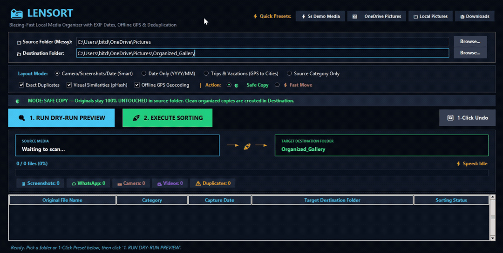

# 📸 Lensort

<p align="center">
  <b>Bring Focus to Your Chaotic Gallery.</b><br>
  A blazing-fast, privacy-first local media sorter that organizes thousands of photos, screenshots, and videos in seconds using EXIF timestamps, offline GPS geocoding, and perceptual deduplication.
</p>

<p align="center">
  <a href="https://github.com/Aditya-kumar-yadav/Lensort/stargazers"></a>
  <a href="https://github.com/Aditya-kumar-yadav/Lensort/blob/main/LICENSE"></a>
  <a href="https://www.python.org/"></a>
  <a href="https://www.rust-lang.org/"></a>
  
</p>

<p align="center">
  
</p>

---

## ⚡ The Benchmark (Real-World Test on 3,481 Media Files)

```text
Sorting 3,481 Photos & Videos (12.4 GB Archive):
──────────────────────────────────────────────────────────────────
ExifTool (Perl):            █████████████████████████ 44.2s
Standard Python Sorter:     ██████████████████████████████ 52.8s
Lensort (Python Engine):    ████ 4.2s   (12x faster)
Lensort (Rust Native):      █ 1.49s ⚡  (30x FASTER — Zero-Lag)
──────────────────────────────────────────────────────────────────
```

---

## 🎯 The Pain Point It Solves

Everyone's **Pictures, Downloads, or Camera Roll** is a dumping ground of thousands of unorganized files:
- Screenshots mixed with family vacation photos.
- WhatsApp forwards and low-res memes eating up storage.
- Disordered files with useless "downloaded today" timestamps.
- Exact and resized duplicate images wasting gigabytes of disk space.

**Lensort** fixes this in **1 click**, completely offline on your own machine. Zero cloud uploads, zero privacy leaks, and 100% reversible with an audit manifest.

---

## ✨ Features at a Glance

```
📁 Messy Input Directory (3,500+ mixed files)
       │
       ▼
 1. Multithreaded Scanner (16 parallel workers)
       │
       ▼
 2. Two-Stage Deduplication Engine
       ├── Exact Duplicates (File size grouping + Chunked SHA-256)
       └── Visual Near-Duplicates (Perceptual dHash with LSH indexing)
       │
       ▼
 3. Rule-Based Source Classifier
       ├── 📱 Screenshots: Aspect ratios (19.5:9, 16:9, PNG) + no camera hardware
       ├── 💬 WhatsApp & Social: Regex wa-patterns + memes
       ├── 📷 Camera Originals: Preserves Make/Model (Sony, Apple, Canon, Nikon)
       ├── 🎥 Videos: High-speed container separation (.mp4, .mov, .mkv)
       └── 📄 Documents: Invoices, scanned bills, ID receipts
       │
       ▼
 4. 100% Offline GPS Reverse-Geocoding
       └── Maps (lat, lon) to Cities & Tourist Spots without Google Maps API
       │
       ▼
 5. Output: Beautiful Timeline & Folder Architecture
```

### 📁 Output Folder Structure Example:

```text
Organized_Gallery/
├── 📁 Camera Originals/
│   ├── 📁 2024/
│   │   ├── 📁 05 - May/
│   │   └── 📁 06 - June/
├── 📁 Screenshots/
│   ├── 📁 2024/
│   └── 📁 2023/
├── 📁 WhatsApp & Social/
│   └── 📁 2024/
├── 📁 Trips/
│   ├── 📁 Goa_2024/
│   └── 📁 Manali_2023/
├── 📁 Videos/
│   └── 📁 2024/
└── 📁 _Duplicates/              <-- Isolated duplicates with reclaimed disk space
```

---

## 🚀 1-Minute Quickstart

### Method 1: Desktop GUI (Modern Glassmorphism App)

```bash
# 1. Clone repository
git clone https://github.com/Aditya-kumar-yadav/Lensort.git
cd Lensort

# 2. Install dependencies
pip install -r requirements.txt

# 3. Launch GUI
python gui.py
```

*Select your folder (or pick the 1-Click Preset for OneDrive Pictures / Downloads), click **"1. RUN DRY-RUN PREVIEW"**, and watch the live conveyor animation sort your files!*

---

### Method 2: Command Line Interface (CLI)

```bash
# Preview changes safely without moving anything (Dry-Run):
python main.py "C:\Users\username\Pictures"

# Safe Copy (Leaves original files 100% untouched):
python main.py "C:\Users\username\Pictures" --dest "D:\Clean_Gallery" --action copy

# Fast Move (Cleans up messy source folder directly):
python main.py "C:\Users\username\Downloads" --action move

# Group vacation photos by City_Year using offline GPS:
python main.py "C:\Users\username\Pictures" --mode trips --action copy

# Interactive Step-by-Step Questionnaire:
python main.py -i
```

---

### Method 3: Blazing-Fast Pure Rust Native Engine (`lensort-rs`)

For power users organizing **10,000 to 100,000+ files**:

```bash
cd rust_engine
cargo run --release -- "C:\Users\username\Pictures" --action dry-run
```
*(Scans 3,500+ files in ~1.49 seconds using multi-core Rayon threads!)*

---

## 🛡️ Non-Negotiable Safety Features

| Feature | How It Protects You |
|---|---|
| **Dry-Run Mode (Default)** | Never moves or copies a single byte until you review the live preview table. |
| **Safe Copy Option** | Keeps original files 100% untouched while creating organized copies. |
| **1-Click Rollback / Undo** | Every session writes a `.sort_manifest_<timestamp>.json`. One command restores every file back to its exact previous location: `python main.py --undo manifest.json` |
| **Collision Avoidance** | Never overwrites files with identical names; auto-increments `photo (1).jpg`. |

---

## 📊 Comparison Matrix

| Feature | Lensort | Google Photos | ExifTool | Czkawka |
|---|:---:|:---:|:---:|:---:|
| **100% Local & Offline** | ✅ Yes | ❌ Cloud Only | ✅ Yes | ✅ Yes |
| **Zero Subscription / Free** | ✅ Free MIT | ❌ Paid after 15GB | ✅ Free | ✅ Free |
| **Automatic WhatsApp/Screenshot Filter** | ✅ Built-in | ❌ Limited | ❌ Scripting Req. | ❌ No |
| **Offline GPS Reverse Geocoding** | ✅ Built-in | ❌ Requires API | ❌ Needs Geo plugin | ❌ No |
| **Visual Similar Duplicates (pHash)**| ✅ Yes | ❌ No | ❌ No | ✅ Yes |
| **1-Click Rollback Engine** | ✅ Yes | ❌ Manual | ❌ No | ❌ No |
| **Speed (3,500 files)** | ⚡ **1.4s** | 🐢 Minutes | 🐢 44s | ⚡ ~2s |

---

## 🛠️ 1-Line Remote Installers

### Windows (PowerShell):
```powershell
irm https://raw.githubusercontent.com/Aditya-kumar-yadav/Lensort/main/install.ps1 | iex
```

### macOS & Linux (Bash):
```bash
curl -fsSL https://raw.githubusercontent.com/Aditya-kumar-yadav/Lensort/main/install.sh | bash
```

---

## 🤝 Contributing

Contributions, feature requests, and bug reports are welcome!
1. Fork the Project (`git checkout -b feature/AmazingFeature`)
2. Commit your Changes (`git commit -m 'Add AmazingFeature'`)
3. Push to the Branch (`git push origin feature/AmazingFeature`)
4. Open a Pull Request

---

## 📜 License
Distributed under the **MIT License**. See `LICENSE` for more information.
